 

 

 

<table>
  <tr>
    <td width="120"><code>languages</code></td>
    <td></td>
  </tr>
  <tr>
    <td><code>frontend</code></td>
    <td></td>
  </tr>
  <tr>
    <td><code>backend</code></td>
    <td></td>
  </tr>
  <tr>
    <td><code>testing</code></td>
    <td></td>
  </tr>
  <tr>
    <td><code>devops</code></td>
    <td></td>
  </tr>
  <tr>
    <td><code>also</code></td>
    <td>
      
      
      
      
      
      
      
      
    </td>
  </tr>
</table>

 

<table>
  <tr><td width="170"><b>Matching engine</b></td><td>Server-side order matching on a live Binance WebSocket feed, with fallback hosts and REST fallbacks</td></tr>
  <tr><td><b>No double fills</b></td><td>Every order is claimed and filled inside one MongoDB transaction; OCO and buy orders reserve funds</td></tr>
  <tr><td><b>Security</b></td><td>In-memory access tokens, rotating httpOnly refresh cookies, Google OAuth, TOTP 2FA with AES-256-GCM secrets</td></tr>
  <tr><td><b>AI assistant</b></td><td>Google Gemini with function calling for live prices and news, guarded against financial advice</td></tr>
  <tr><td><b>Quality</b></td><td>140+ automated tests (Jest, Supertest, Vitest) · GitHub Actions CI · Render + Vercel</td></tr>
</table>

  

<table>
  <tr><td width="170"><b>MetaTrader 5</b></td><td>Live and demo accounts through the MT5 gateway API, saved as pending first, with automatic session re-login</td></tr>
  <tr><td><b>Funding</b></td><td>Deposits and withdrawals in PostgreSQL transactions, kept in sync with MT5 balances and deal IDs</td></tr>
  <tr><td><b>Access control</b></td><td>Roles-and-permissions matrix of 12 modules × 7 actions, checked on every API route</td></tr>
  <tr><td><b>Compliance</b></td><td>KYC review queue; money actions stay blocked until KYC is approved</td></tr>
  <tr><td><b>Real time</b></td><td>Support tickets and admin alerts over Socket.IO · Nginx + PM2 · GitHub Actions deploys</td></tr>
</table>

  

<table>
  <tr><td width="170"><b>Class scheduler</b></td><td>Cron-driven reminders and after-class notes for every student, in Malayalam, English and Kannada</td></tr>
  <tr><td><b>Attendance</b></td><td>Students send a server-generated session code on WhatsApp, are marked present and get the notes</td></tr>
  <tr><td><b>Send governor</b></td><td>One adaptive rate limit per number; class messages first; automatic back-off on Meta rate limits</td></tr>
  <tr><td><b>Performance</b></td><td>Planner payload cut from ~320 KB to ~37 KB with compact Postgres RPCs</td></tr>
  <tr><td><b>Quality</b></td><td>60+ SQL migrations · ~200 Vitest test files · load-test harness against a fake Meta API</td></tr>
</table>

  

<table>
  <tr>
    <td width="170"><code>Oct 2025 → now</code></td>
    <td><b>Full Stack Developer</b> · Wisbato, Kozhikode Build and maintain full-stack systems for client businesses: a WhatsApp CRM and HighCRM, a forex brokerage CRM on MetaTrader 5.</td>
  </tr>
  <tr>
    <td><code>Jan → Aug 2025</code></td>
    <td><b>Full Stack Developer Intern</b> · Luminar Technolab RESTful APIs in Node.js and Express with JWT and role-based access, plus 30+ reusable React components with Redux and Tailwind CSS.</td>
  </tr>
</table>

 

<picture>
  <source media="(prefers-color-scheme: dark)" srcset="https://streak-stats.demolab.com?user=Arjunsathia&hide_border=true&background=0d1117&ring=4493f8&fire=4493f8&currStreakNum=e6edf3&currStreakLabel=4493f8&sideNums=e6edf3&sideLabels=9198a1&dates=6e7681&stroke=30363d" />
  
</picture>

<picture>
  <source media="(prefers-color-scheme: dark)" srcset="https://github-readme-activity-graph.vercel.app/graph?username=Arjunsathia&bg_color=0d1117&color=9198a1&line=4493f8&point=e6edf3&area=true&area_color=4493f8&hide_border=true&custom_title=Contribution%20activity" />
  
</picture>

<picture>
  <source media="(prefers-color-scheme: dark)" srcset="https://raw.githubusercontent.com/Arjunsathia/Arjunsathia/output/github-snake-dark.svg" />
  
</picture>

  

